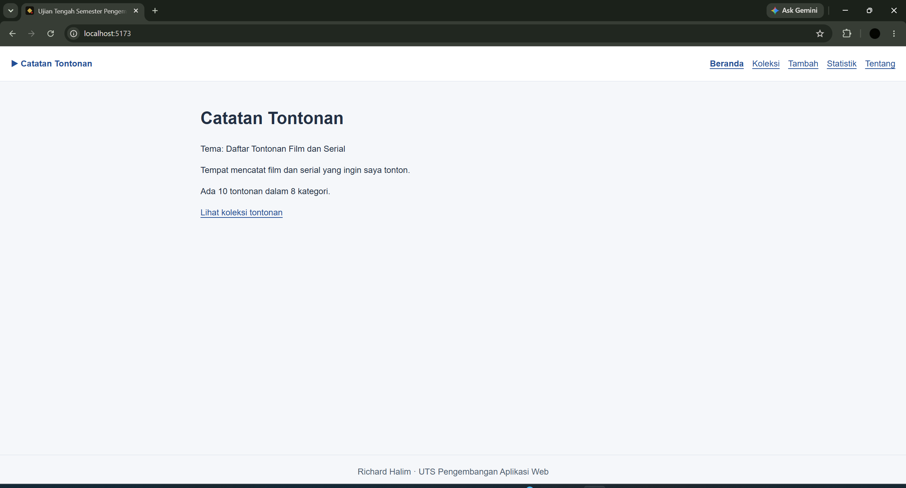
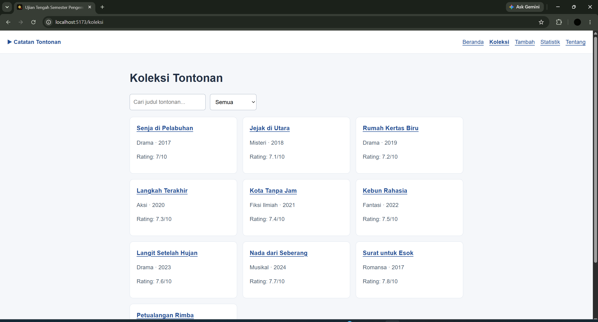
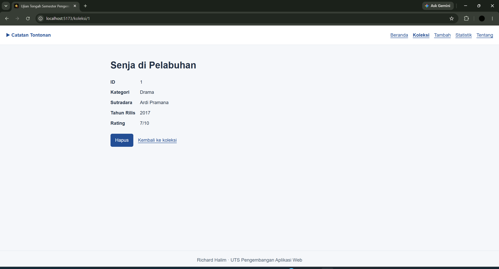
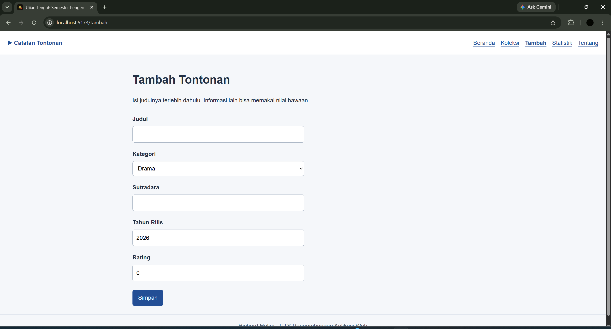
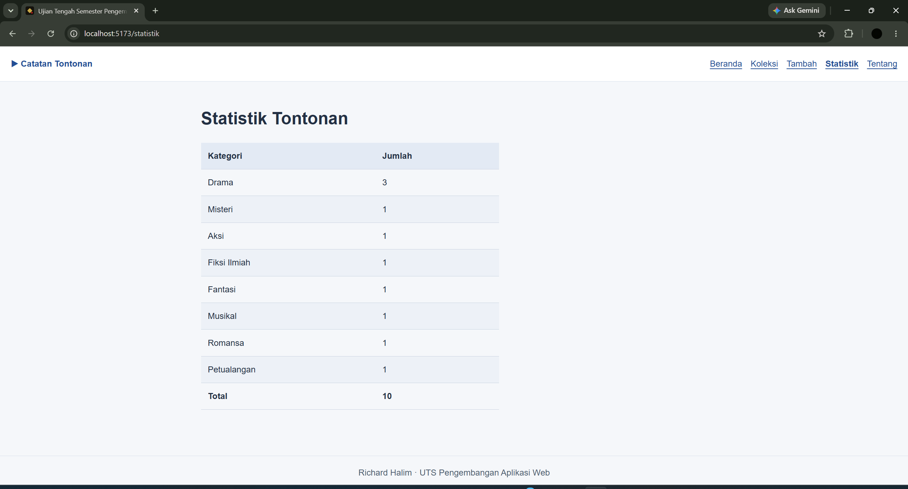
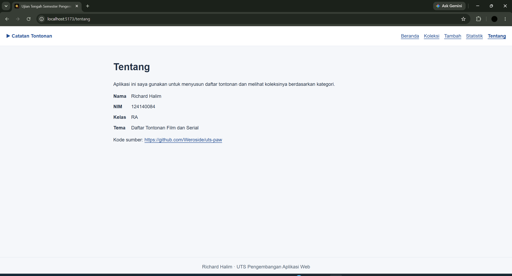
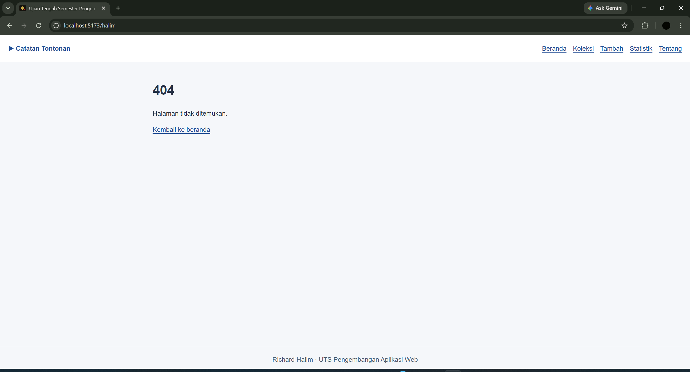

# Catatan Tontonan

```markdown
Nama: Richard Halim  
NIM: 124140084  
Kelas: RA  
Tema: Daftar Tontonan Film dan Serial  
Deployment: https://weroside.github.io/uts-paw/
```

- **Halaman Beranda**


- **Halaman Koleksi**


- **Halaman Detail Koleksi**


- **Halaman Tambah**


- **Halaman Statistik**


- **Halaman Tentang**


- **Halaman 404 Tidak DItemukan**


## Fitur

- Ringkasan jumlah tontonan dan kategori.
- Pencarian judul dan filter kategori.
- Detail sutradara, tahun rilis, dan rating.
- Tambah dan hapus tontonan dengan penyimpanan localStorage.
- Statistik koleksi, halaman identitas, dan halaman 404.
- Tampilan responsif.

## Menjalankan secara lokal

```markdown
cd app
npm install
npm run dev
```

## Konsep React yang dipakai

- Komponen dan props untuk menyusun tampilan.
- useState untuk mengelola input dan filter.
- useEffect untuk mengambil dan menyimpan data.
- Context API dan custom hook untuk mengelola koleksi.
- React Router untuk navigasi antarhalaman.
- Form terkontrol, validasi, dan rendering bersyarat.