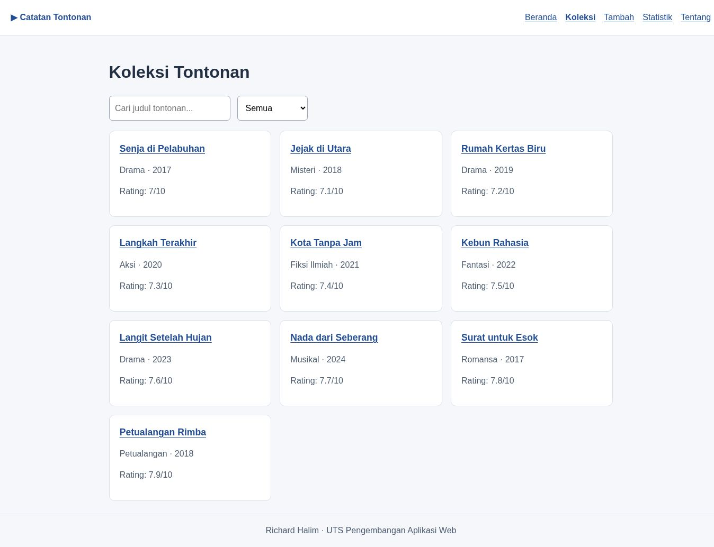

# Catatan Tontonan

Nama: Richard Halim  
NIM: 124140084  
Kelas: RA  
Tema: Daftar Tontonan Film dan Serial  
Deployment: https://weroside.github.io/uts-paw/



## Fitur

- Ringkasan jumlah tontonan dan kategori.
- Pencarian judul dan filter kategori.
- Detail sutradara, tahun rilis, serta rating.
- Penambahan dan penghapusan tontonan dengan penyimpanan localStorage.
- Statistik jumlah tontonan per kategori.
- Halaman identitas dan penanganan alamat yang tidak dikenal.
- Tampilan menyesuaikan ukuran layar.

## Menjalankan secara lokal

Pastikan Node.js versi 20 atau lebih baru sudah terpasang.
Dari folder utama proyek, jalankan:

```bash
cd app
npm install
npm run dev
```